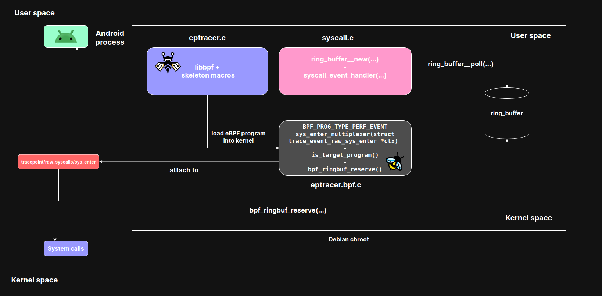
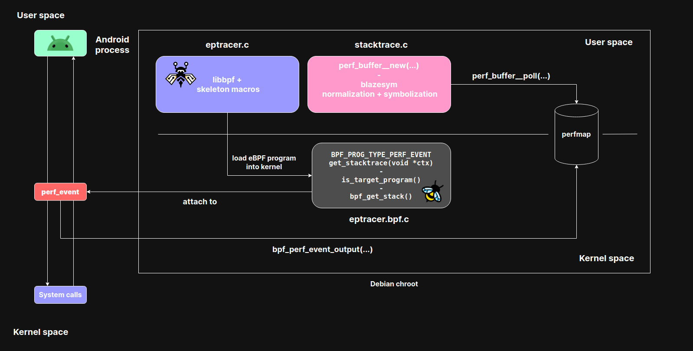

# ePtracer

eBPF process analyzer for **Linux and Android**: see what a process does and what it
exchanges over the network, **TLS included**, and put an intercepting proxy (Burp Suite,
ZAP, mitmproxy, Caido) in its path. You do not configure the app, install a CA or patch an APK.

One static binary per architecture, root only, nothing to install on the target.

## Contents

- [What it can do](#what-it-can-do)
- [Supported platforms](#supported-platforms)
- [Install](#install)
- [Usage](#usage)
  - [Syscalls and stack traces](#syscalls-and-stack-traces)
  - [Reading HTTP/HTTPS traffic (`-H`)](#reading-httphttps-traffic--h)
  - [Intercepting through a proxy (`-I`)](#intercepting-through-a-proxy--i)
  - [Intercepting pinned apps (`--tls-mode splice`)](#intercepting-pinned-apps---tls-mode-splice)
  - [Android apps](#android-apps)
  - [All options](#all-options)
- [How it works](#how-it-works)
- [Known limits](#known-limits)
- [Build](#build)
- [Testing](#testing)

## What it can do

| Feature | Flag | In short |
| --- | --- | --- |
| Syscall tracing | `-S` | Every syscall of the process, with decoded arguments |
| Stack sampling | `-s` | User and kernel frames, symbolized |
| HTTP/HTTPS decoding | `-H` | Read inside the process, so certificate pinning does not apply. HTTP/1.x and HTTP/2 messages come out whole, byte for byte |
| Real interception | `-I` | The proxy can stall, edit and drop requests. No proxy settings or iptables; the proxy CA is trusted automatically for a spawned process |
| Pinning-proof interception | `-I --tls-mode splice` | The app keeps its real TLS session and ePtracer decrypts it with the app's own keys. No CA anywhere; HTTP/1.1, HTTP/2 and WebSocket supported; each request reaches the server at most once |
| Android apps by package | `--package` | The whole app, started now or later, including TLS libraries loaded at run time or shipped inside the APK |
| Process trees | `-F` | Follows forked children, like `strace -f` |

TLS stacks covered: **OpenSSL / BoringSSL** (including Android Conscrypt and Cronet), **NSS**,
**GnuTLS**, **wolfSSL**, **mbedTLS** and **Go `crypto/tls`**.

## Supported platforms

| Architecture | Binary | Runs on |
| --- | --- | --- |
| **x86_64** | `eptracer-<version>-linux-x86_64` | Linux, Android emulator |
| **aarch64** (arm64) | `eptracer-<version>-linux-aarch64` | Linux, Android devices |

The binary is the same for every distribution and Android release: it is statically linked
against musl, and CO-RE/BTF makes the BPF side portable. Support depends on the **kernel** only:

| Requirement | Why |
| --- | --- |
| Linux **≥ 5.10** | Ring buffers, `cgroup/getpeername4`, `tp_btf` |
| BTF (`/sys/kernel/btf/vmlinux`) | CO-RE relocations |
| uprobes, cgroup v2 at `/sys/fs/cgroup` | TLS capture, interception (`-I`) |
| root | Loading BPF programs |

| Platform | Supported | Not supported |
| --- | --- | --- |
| **Linux** | Ubuntu 20.04 (HWE) / 22.04 / 24.04+, Debian 11+, RHEL / Rocky / Alma 9+, Fedora, Arch, Alpine, openSUSE, Amazon Linux 2 and 2023 | Ubuntu 20.04 on its 5.4 GA kernel, Debian 10, RHEL 8 |
| **Android** | **Android 13+**, and Android 12 devices with a GKI 5.10 kernel that ships BTF | Android 11, devices upgraded on 4.19/5.4 kernels, Android 12/12L emulators (no BTF) |

```sh
sudo eptracer --check   # checks this kernel and test-loads every BPF program
```

Details are in [docs/internals.md](docs/internals.md#kernel-requirements-in-detail).

## Install

Download the binary for your architecture from the
[releases](https://github.com/faccimatteo/ePtracer/releases). Each release has checksums in
`SHA256SUMS` and attested build provenance.

```sh
# Linux
sudo ./eptracer-linux-x86_64 --check

# Android (rooted device)
adb push eptracer-linux-aarch64 /data/local/tmp/eptracer
adb shell su -c '/data/local/tmp/eptracer --check'
```

Optional: `certutil` (`libnss3-tools`), only for `-I` against NSS apps (Firefox, Thunderbird, Chromium).

## Usage

Pick the target with **`-p "cmd"`** (spawn), **`-P PID`** (attach), **`--package APP`** or
**`--uid UID`**, then add what you want to see.

### Syscalls and stack traces

```sh
sudo ./eptracer -P 4242 -S            # syscalls
sudo ./eptracer -P 4242 -s            # stack samples
sudo ./eptracer -p ./run.sh -S -F     # a script and every process it starts
```

### Reading HTTP/HTTPS traffic (`-H`)

This mode is read-only. It works through pinning and needs no proxy.

```sh
sudo ./eptracer -p "curl -s https://example.com" -H   # spawn and decode
sudo ./eptracer -P 4242 -H -t -o                      # TLS only, HTTP only
sudo ./eptracer -P 4242 -H -d -D ./captured           # readable bodies + one file per message
sudo ./eptracer -P 4242 -H --ssl-lib /path/libcustomssl.so
```

```
═══════════════════════════════════════════════════════════════════════════
 #1  REQUEST   POST https://api.example.com/v1/login
      14:22:07.481920  TLS  93.184.216.34:443  pid=8123 tid=8140 comm=curl  184 bytes
───────────────────────────────────────────────────────────────────────────
POST /v1/login HTTP/1.1
Host: api.example.com
Content-Type: application/json
Content-Length: 37

{"user":"admin","password":"hunter2"}
```

| Option | Effect |
| --- | --- |
| *(default)* | Raw messages, byte for byte (CRLF, chunks, compressed bodies), ready to replay |
| `-d` | Unchunks and inflates bodies (gzip/deflate) and restates the headers |
| `-D DIR` | One file per message (`0001-request.http`, …) |
| `--http-chunks` | Live chunk view, also for non-HTTP traffic (WebSocket, other protocols) |

### Intercepting through a proxy (`-I`)

The proxy really is in the path: **Intercept stalls the app, an edit changes what the server
receives, a drop closes the app's connection.**

```sh
sudo ./eptracer -p "curl https://example.com" -I 8080 -H      # Burp on 127.0.0.1:8080, CA auto-trusted
sudo ./eptracer -P 4242 -I 8080 --intercept-ports 80,443      # only some ports
sudo ./eptracer -P 4242 -I 8080 --proxy-ca ./proxy-ca.pem     # proxy other than Burp/mitmproxy
sudo ./eptracer -P 4242 -I direct                             # no proxy: check the redirect works
```

- **CA trust.** For `-p`, ePtracer fetches the CA from the proxy and exports it to the child's
  trust-store variables. For NSS apps it imports the CA into the app's own `cert9.db`. Nothing
  is installed machine-wide.
- **Attached process (`-P`).** The app must already trust the proxy CA, or you use splice.
- **User.** The spawned process runs as the user behind `sudo`, not as root, so GUI and Electron
  apps start normally.
- **Pinning.** A pinned app refuses this mode, because it is a real man in the middle. Use splice.

### Intercepting pinned apps (`--tls-mode splice`)

The app completes its handshake with the **real server**, so pinning, Certificate Transparency
and mTLS all hold. ePtracer decrypts with the session keys read inside the process, hands each
request to the proxy, and re-encrypts what the proxy releases.

```sh
sudo ./eptracer -p "curl --pinnedpubkey sha256//… https://example.com" -I 8080 --tls-mode splice
sudo ./eptracer -P 4242 -I 8080 --tls-mode splice -v
```

Set ePtracer as the proxy's **upstream proxy** at `127.0.0.1:8082`:

- Burp: Settings → Network → Connections → Upstream proxy servers, destination `*`.
- Caido: Upstream Proxies.

Behaviour:

- **At most once.** Repeats and retries are refused, never delivered twice.
- **QUIC.** UDP/443 is blocked so the app falls back to HTTP/2. `--no-block-quic` lets it through.
- **`--splice-strict`.** Closes connections the proxy cannot see (no key, TLS 1.2, non-HTTP).
  Without it, they pass through uninspected.

### Android apps

The `aarch64` binary runs directly on a rooted device. Apps are selected by package, so no PID
is needed:

```sh
# read-only, pinning-proof
./eptracer --package com.example.app -H

# through Burp on the workstation
adb reverse tcp:8080 tcp:8080      # on the host: device 127.0.0.1:8080 → proxy
adb forward tcp:8082 tcp:8082      # on the host: proxy upstream → device bridge
./eptracer --package com.example.app -I 127.0.0.1:8080 --tls-mode splice -v
```

Conscrypt (OkHttp, Retrofit, `HttpURLConnection`), Cronet and Flutter are all covered.
**Splice is the mode to use on Android**: system apps cannot be handed a CA and most apps pin.
Tested against Google Maps (Cronet, HTTP/2, pinned) and Etsy.

### All options

```
    -h, --help                show this help message and exit
    -f, --log-file=<str>      log to FILE instead of stdout
    -p, --program=<str>       program to spawn and trace
    -P, --pid=<str>           PID to attach to
    --package=<str>           trace every process of this Android app (uid from packages.list),
                              started now or later
    --uid=<int>               trace every process running as this uid
    -L, --ssl-lib=<str>       comma separated TLS libraries to hook (default: autodetect)
    -F, --follow-forks        trace the child processes of the target too
    -s, --show-stacktrace     trace process stack frames
    -S, --show-syscall        trace process syscalls
    -H, --show-http           decode process HTTP traffic (TLS and cleartext)
    -t, --tls-only            capture TLS traffic only, ignore cleartext sockets
    -o, --http-only           drop captured payloads that do not look like HTTP
    -d, --http-decode         unchunk and decompress message bodies, restating the headers that describe them
    -D, --http-dump-dir=<str> write each raw message to its own file in DIR
    --http-chunks             show the captured chunks live instead of reassembling messages
    -I, --intercept=<str>     put an intercepting proxy in the path (HOST:PORT, default
                              127.0.0.1:8080; 'direct' relays to the real servers)
    --intercept-port=<int>    loopback port the redirected connections land on (default: 8081)
    --intercept-ports=<str>   comma separated destination ports to intercept (default: all)
    --tls-mode=<str>          with -I: 'mitm' (default) tunnels TLS to the proxy, which presents
                              its own certificate; 'splice' keeps the app's session with the real
                              server (pinning holds, no CA to trust) and decrypts it with the keys
                              read inside the process
    --bridge-port=<int>       splice: port the proxy uses as its upstream proxy (default: 8082)
    --splice-strict           splice: close a connection rather than let through anything the proxy
                              could not see (no key, TLS 1.2, not HTTP)
    --splice-hold-ms=<int>    splice: how long a client record waits for its key (default: 200)
    --no-block-quic           splice: do not refuse the target's UDP/443 (leave QUIC/HTTP3 flowing,
                              uncaptured)
    --proxy-ca=<str>          proxy CA to trust for the spawned process (PEM or DER);
                              autodetected from the proxy when omitted
    --check                   check whether this kernel can run ePtracer and exit
    -v, --verbose             verbose debug output
```

## How it works

ePtracer has a kernel side (eBPF, `src/eptracer.bpf.c`) and a userspace side (`src/eptracer.c`,
`src/tracers/`), which talk through BPF maps and ring buffers. The full write-up is in
[docs/internals.md](docs/internals.md). The splice design is in
[docs/design/tls-splice-proxy.md](docs/design/tls-splice-proxy.md).

**Syscall tracing.** A `raw_syscalls/sys_enter` tracepoint filters events for the target and
pushes them to a ring buffer, which `tracers/syscall.c` decodes:



**Stack traces.** A `perf_event` program samples the target with `bpf_get_stack()`, and
`tracers/stacktrace.c` symbolizes the frames with blazesym:



**HTTP decoding.** Uprobes on the TLS library read the plaintext *before* encryption and *after*
decryption, while socket tracepoints cover cleartext HTTP:

```
                 target process
  ┌────────────────────────────────────────────┐
  │  app code                                  │
  │      │ SSL_write(ssl, "GET / HTTP/1.1…")   │
  │      ▼                                     │
  │  libssl.so  ── uprobe ────────────────►  plaintext, before encryption
  │      │                                     │
  │      │ write(fd, "\x17\x03\x03…")          │
  └──────┼─────────────────────────────────────┘
         ▼
      kernel  ── tracepoint ─────────────────►  cleartext HTTP only
```

**Interception.** A `cgroup/connect4` program sends each connection to a loopback slot that
encodes its real destination. The SNI or `Host` header gives the authority for the proxy's
`CONNECT`:

```
   traced app                    kernel                 ePtracer            Burp
  ────────────      ──────────────────────────    ────────────────    ────────────
   connect(1.2.3.4:443)
        │
        └──▶ cgroup/connect4 ── rewrite ──▶ 127.0.0.7:8081 ──▶ accept()
                    │                                              │
                    └─ orig_dst_map[5] = 1.2.3.4:443               │  SNI: api.example.com
                                                                   └──▶ CONNECT api.example.com:443
                                                                        (Intercept / edit / drop)
```

On Android 15+, netd owns the connect hook exclusively, so the redirect happens at the
`connect(2)` syscall entry instead.

## Known limits

- **TLS stacks.** No `rustls`, no pure-Java JSSE (desktop), and no statically linked, stripped
  BoringSSL (Flutter, some Cronet builds) for `-H`. `-I` covers them all, because it does not
  depend on the library.
- **Go.** Stripped binaries and Go older than 1.17 are not hooked.
- **`-d`.** Inflates `gzip` and `deflate` only; `br` and `zstd` are left as they are.
- **Attaching mid-connection.** Connections already open fall back to the chunk view.
- **`-I` and IPv6.** Sockets pinned with `IPV6_V6ONLY` cannot be redirected. UDP (QUIC, DNS)
  is not intercepted in mitm mode.
- **Listener port.** The `--intercept-port` listener accepts loopback only, but the port is
  open: do not expose it to untrusted networks.

The full list per feature is in [docs/internals.md](docs/internals.md).

## Build

```sh
git clone --recursive https://github.com/faccimatteo/ePtracer.git && cd ePtracer
./scripts/build-static.sh   # static binary in Docker (Alpine): dist/eptracer-$(uname -m)
```

This produces the release binary for the host architecture. For `aarch64` on an x86_64 host,
use QEMU binfmt with `DOCKER_PLATFORM=linux/arm64`.

For development, a dynamic build on the host:

```sh
./build.sh                                        # installs toolchains, fetches submodules, runs make
git submodule update --init --recursive && make   # if the dependencies are already there
```

Submodules: **bpftool** (with **libbpf**), **blazesym**, **argparse**, **log.c**.

## Testing

| Suite | Covers | Runs on |
| --- | --- | --- |
| unit (`bench/run_unit.sh`) | TLS records, key store, anchor search, HTTP/1 framing | every build |
| kernel (`tests/e2e/run.sh`) | Every feature on 5.10, 5.15, 6.1, 6.6, 6.12, 6.18, 7.2, RHEL 9 and bpf-next; 5.4 must be refused | [little-vm-helper](https://github.com/cilium/little-vm-helper) VMs |
| distro (`tests/distro/run.sh IMAGE`) | TLS libraries of 10 distributions, x86_64 and arm64 | privileged containers |
| android (`tests/android/run.sh`) | Conscrypt, `--package`, splice, Android 15+ redirect on API 33–36; API 30–32 must be refused | x86_64 emulator |

```sh
sudo tests/e2e/run.sh                     # this machine
tests/distro/run.sh fedora:latest         # a distribution, in Docker
tests/android/run.sh -s emulator-5554     # emulator or rooted device
```

CI (`.github/workflows/ci.yml`) runs every suite and writes a compatibility table to the run
summary. A `v*` tag publishes the binaries.
