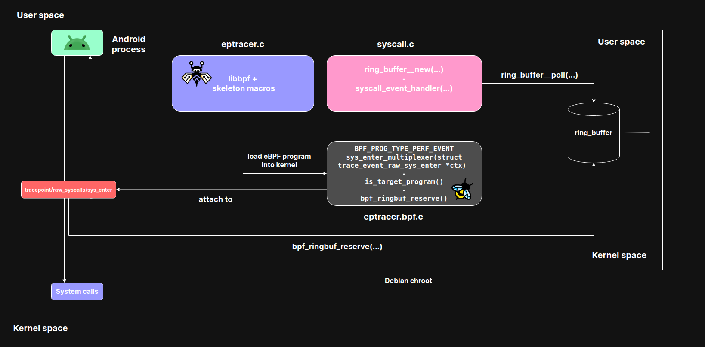
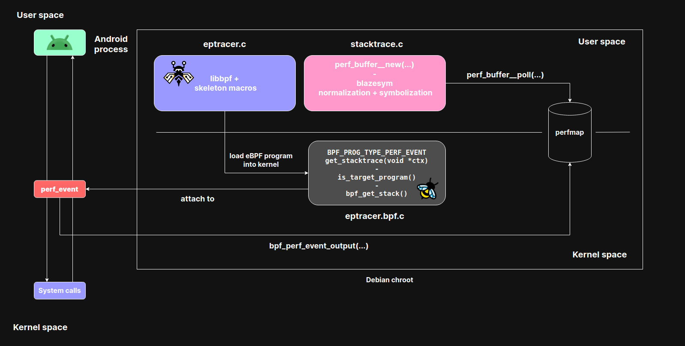

# ePtracer internals

How ePtracer works under the hood, and the known limits of each feature. For
what the tool does and how to use it, see the [README](../README.md).

- [Architecture](#architecture)
- [Kernel requirements, in detail](#kernel-requirements-in-detail)
- [HTTP decoding](#http-decoding)
- [Interception (`-I`)](#interception--i)
- [Splice (`--tls-mode splice`)](#splice---tls-mode-splice)
- [Android](#android)

## Architecture

ePtracer is split in a kernel side (eBPF) and a userspace side, talking through BPF maps.

**Syscall tracing** — `eptracer.bpf.c` attaches to the `tracepoint/raw_syscalls/sys_enter` tracepoint, filters events for the target process and pushes them to a ring buffer, polled and decoded by `tracers/syscall.c`:



**HTTP decoding** — `eptracer.bpf.c` hooks the TLS library of the target process with uprobes and captures the payloads at the two ends of the encryption, while syscall tracepoints cover cleartext HTTP. Events go through a dedicated ring buffer, decoded by `tracers/http.c`:

```
                 target process
  ┌────────────────────────────────────────────┐
  │  app code                                  │
  │      │ SSL_write(ssl, "GET / HTTP/1.1…")   │
  │      ▼                                     │
  │  libssl.so  ── uprobe ────────────────►  plaintext, before encryption
  │      │                                     │
  │      │ write(fd, "\x17\x03\x03…")          │
  └──────┼─────────────────────────────────────┘
         ▼
      kernel  ── tracepoint ─────────────────►  cleartext HTTP only
```

Two capture points, one ring buffer:

- **TLS layer** — uprobe/uretprobe pairs on the read and write functions of the TLS library the process actually uses. The payload is read from the process own buffers *before* encryption and *after* decryption. Nothing is intercepted on the wire, so there is no certificate to validate and **SSL pinning is bypassed by construction**: no MITM proxy, no user CA to install, no need to patch the APK.

  There is no generic hook for this, and there cannot be one: TLS is a userspace concern, so the boundary between plaintext and ciphertext exists only inside a function of a specific library, and eBPF can hook nothing it cannot name. Covering "every process" means covering the ABIs — which is cheap, because they all move data with the same calling shape, `(handle, buffer, length)` returning a byte count, so the same two BPF programs serve all of them and only the symbols differ:

  | Stack | Hooked symbols | Typically |
  | ----- | -------------- | --------- |
  | OpenSSL / BoringSSL | `SSL_write`, `SSL_read`, `SSL_write_ex`, `SSL_read_ex` | curl, nginx, Python, Node, .NET, Android Conscrypt, Cronet, Flutter |
  | NSS (NSPR) | `PR_Write`, `PR_Read`, `PR_Send`, `PR_Recv` | Firefox, Thunderbird, anything Gecko |
  | GnuTLS | `gnutls_record_send`, `gnutls_record_recv` | wget, parts of the GNOME stack |
  | wolfSSL | `wolfSSL_write`, `wolfSSL_read` | embedded and IoT firmware |
  | mbedTLS | `mbedtls_ssl_write`, `mbedtls_ssl_read` | embedded and IoT firmware |
  | Go `crypto/tls` | `crypto/tls.(*Conn).Write`, `crypto/tls.(*Conn).Read` | Docker, Kubernetes, Terraform, anything Go |

  NSS deserves a note. It has nothing to do with the OpenSSL ABI: it layers `PRFileDesc`s, the TLS layer sits above the TCP one, and the application reads through NSPR — so `PR_Read()` on a TLS socket already returns decrypted bytes. Only the *outermost* call is caught, which is exactly right: the TLS layer reaches the socket below it through a method pointer rather than through the exported `PR_Recv` symbol, so the ciphertext never shows up. The flip side is that NSPR carries every kind of I/O the process does, files and pipes included, so `-o/--http-only` is worth having on with it.

  **Go** is the one that does not fit the pattern, and it gets its own module (`tracers/go_tls.c`). It links its TLS in statically, so there is no library to look for — the symbols are in the executable itself. It passes arguments in registers of its own choosing rather than the C ABI: the receiver in `RAX`, the slice pointer in `RBX`, its length in `RCX` (`R0`/`R1`/`R2` on arm64). And a **uretprobe on Go code is not awkward but unsafe**: the kernel builds one by replacing the return address on the stack with a trampoline, and the Go runtime walks its own frames by return address every time it grows, shrinks or copies a goroutine stack — it finds an address belonging to no function it knows, and panics. Attaching one is a way of crashing the process being observed.

  So `Write` is captured at entry, where the plaintext is already in the buffer and no return is needed at all, and `Read` has its **`RET` instructions probed directly**. Finding them means decoding the function, because scanning for the byte `0xC3` is not the same as finding a `RET`: in Docker's own `Conn.Read` there are nine of those bytes and seven returns, and a probe on one of the two impostors would write a breakpoint into the middle of an instruction and take the process down. The length decoder in `go_tls.c` walks the function from its first byte, and **nothing is attached unless the walk lands exactly on its last one** — a partial decode is not a partial result, it is a set of offsets that may not be instruction boundaries. When it refuses, requests are still captured and only responses are lost. On arm64 there is nothing to decode: instructions are four aligned bytes and a return is one of them.

  Goroutines make the bookkeeping different too. A `Read` that blocks hands its thread to another goroutine, which may well be blocked in `Read` as well, so keying the pending arguments by thread would let the second call overwrite the first. They are keyed by the register the Go ABI reserves for the current `g` instead — a goroutine identity that, unlike the `goid` field inside it, does not move between releases.

  **kTLS** is the one case where the plaintext really does cross the syscall boundary: the kernel does the crypto, the process writes cleartext with `send(2)`, and the socket tracepoints below already capture it — no uprobe needed.
- **Socket layer** — `sys_enter_write`/`sendto` and `sys_exit_read`/`recvfrom` tracepoints for cleartext HTTP.

Peer addresses are resolved without reading a single kernel structure: `connect(2)` is traced to build a `(pid, fd) → peer` map, every socket syscall records the last socket touched by the calling thread, and the SSL uretprobes read that back — the `write(2)` always happens inside the `SSL_write()` call, on the same thread.

A socket is remembered as HTTP the first time a start line shows up on it, so continuation chunks are captured too. Sockets that never show one are left alone, which is what keeps TLS ciphertext (written on the very descriptors the uprobes already cover) out of the output.

**Message reassembly** — the probes deliver whatever the process handed to the TLS library, in chunks of at most 4 KiB: one request can span several events and a keep-alive connection carries several messages in a row. `tracers/http_message.c` buffers those chunks per connection and per direction and applies the HTTP/1.x framing rules — `Content-Length`, chunked transfer encoding, bodies delimited by the end of the connection, bodyless responses to `HEAD`, `204` and `304` — to find where each message ends, then prints the message **byte for byte**: same CRLF line endings, same chunk markers, same compressed bytes, nothing escaped and nothing inserted. What you read is a raw HTTP message, and it can be saved, diffed or replayed as is.

`--http-decode` asks for the body to be unchunked and inflated instead. Doing that while leaving `Transfer-Encoding: chunked`, `Content-Encoding: gzip` and the old `Content-Length` in place would produce a message whose headers contradict its body, so those fields are dropped and `Content-Length` is restated: the result is still a valid HTTP message, which is exactly what a proxy hands to its client after unpacking.

**In-path interception** — `--intercept` puts the proxy genuinely on the wire: a `cgroup/connect4` program rewrites the destination of every TCP connection the traced process opens, so the connection is delivered to a listener ePtracer owns, which tunnels it to the proxy. Everything the proxy does to a request — stalling it in Intercept, editing it, dropping it — is felt by the application.

For an HTTPS connection the proxy terminates TLS and presents a certificate signed by its own CA, which the process would reject. `tracers/http_ca.c` removes the manual step this normally implies: before the traced process is spawned it obtains the proxy CA — fetched from the proxy's own cert endpoint (`http://burp/cert`, `http://mitm.it/cert/pem`), or read from `--proxy-ca` — merges it with the system trust store into a temporary bundle, and exports the trust-store environment variables (`SSL_CERT_FILE`, `CURL_CA_BUNDLE`, `NODE_EXTRA_CA_CERTS`, …) the child inherits. OpenSSL, Go, curl, Node, Python and friends then trust the proxy with nothing installed on the machine. It applies to a spawned process (`-p`) only, and cannot defeat pinning — but the uprobe capture decodes the plaintext there regardless.

```
   traced app                    kernel                 ePtracer            Burp
  ────────────      ──────────────────────────    ────────────────    ────────────
   connect(1.2.3.4:443)
        │
        └──▶ cgroup/connect4 ── rewrite ──▶ 127.0.0.7:8081 ──▶ accept()
                    │                                              │
                    └─ orig_dst_map[5] = 1.2.3.4:443               │  SNI: api.example.com
                                                                   └──▶ CONNECT api.example.com:443
                                                                        (Intercept / edit / drop)
```

The original destination is the hard part: `connect(2)` is rewritten before a source port even exists, so the usual `(saddr, sport)` correlation is not available yet and `SO_ORIGINAL_DST` belongs to netfilter. ePtracer encodes it in the address it redirects to instead — `127.0.0.0/8` is sixteen million locally deliverable addresses, so connection *N* goes to `127.0.0.0 | (N + 2)` and its real destination is parked in `orig_dst_map[N]`. A plain `getsockname(2)` on the accepted socket pairs the two: no race, no heuristics, no extra kernel hook. `cgroup/getpeername4` puts the original address back, so a process asking who it is connected to is told what it expects.

The authority is recovered from the bytes themselves, peeked before a single one is forwarded: the SNI of the TLS ClientHello, or the `Host` header of a cleartext request. That is what makes Burp mint its certificate for the right host and its history read like the application's own, instead of showing bare IP addresses.

**Backtrace analysis** — a `perf_event` program samples the target process, captures its stack with `bpf_get_stack()` and pushes it to a perf buffer, polled by `tracers/stacktrace.c` which symbolizes the frames via blazesym:



- `src/eptracer.bpf.c` — eBPF programs and maps. Filters events by target PID/program name (via `program_map`).
- `src/eptracer.c` — userspace entry point: parses arguments, loads the auto-generated skeleton (`eptracer.skel.h`), attaches programs, polls events.
- `src/tracers/` — event consumers: syscall decoding, stack trace symbolization, HTTP capture (`http.c`), HTTP/1.x message reassembly (`http_message.c`), HTTP/2 frame and HPACK decoding (`http2_message.c`), in-path interception (`http_intercept.c`) and automatic proxy CA trust (`http_ca.c`). The TLS splice is split across `tls_anchor.c` (finding the key-derivation function by its NSS labels, and the SHA-2 HMAC fallback), `tls_keys.c` (the key store with trial decryption), `tls_record.c` (the TLS 1.3 record layer), `tls_splice.c` (the per-connection state machine), `splice_bridge.c` / `splice_bridge_h2.c` (the proxy sandwich and its HTTP/2 termination) and `splice_session.c` (wiring it into the interceptor). The design is written up in [`docs/design/tls-splice-proxy.md`](design/tls-splice-proxy.md).
- `vmlinux/<arch>/vmlinux.h` — pre-generated kernel type headers (CO-RE), so no kernel headers are needed at build time.

Vendored dependencies (git submodules): **bpftool** (skeleton generation, also provides **libbpf**), **blazesym** (Rust library for symbolization), **argparse**, **log.c**.

## Kernel requirements, in detail

| Requirement | Why |
| --- | --- |
| Linux **5.10** or newer | BPF ring buffers (5.8), `cgroup/getpeername4` (5.8), `bpf_probe_read_user` and `tp_btf` (5.5); 5.10 is the first LTS carrying them all |
| `CONFIG_DEBUG_INFO_BTF=y` (`/sys/kernel/btf/vmlinux`) | CO-RE relocations and `tp_btf/sched_process_fork` |
| uprobes, cgroup v2 at `/sys/fs/cgroup` (for `-I`) | TLS capture, interception |
| root | loading BPF programs |

In practice:

- **Linux** — Ubuntu 20.04 (HWE kernel), 22.04, 24.04+, Debian 11+, RHEL/Rocky/Alma 9+,
  Fedora, Arch, Alpine, openSUSE, Amazon Linux 2 (5.10 kernel) and 2023. Not supported: Ubuntu
  20.04 on its 5.4 GA kernel, Debian 10, RHEL 8 (4.18).
- **Android** — devices running a **GKI kernel 5.10 or newer**: Android 12+ devices that
  *launched* on 12 or later (`android12-5.10`, `android13-5.15`, `android14-6.1`, …). A device
  upgraded to Android 12/13 but still on a 4.19/5.4 kernel is not supported, and neither is
  Android 11 (5.4). `uname -r` on the device tells. The kernel also needs BTF
  (`/sys/kernel/btf/vmlinux`): `android12-5.10` builds can lack it — the Android 12/12L
  emulator kernels do, so the CI expects them to be refused — while the `android13-*` and
  later GKI kernels ship it. `--check` tells for a given device.

`eptracer --check` answers for the machine it runs on: it checks the kernel, BTF, uprobes,
cgroup v2 and the BPF features, then loads every BPF program through the verifier on its own
and reports which feature a rejected one would cost.

GKI kernels are built without `CONFIG_FTRACE_SYSCALLS`, so the per-syscall tracepoints
(`syscalls/sys_enter_*`) do not exist there; the socket capture of `-H` and the trust-store
detection of `-I` fall back on `raw_syscalls`, dispatching on the syscall number.

From Android 15, netd attaches its own cgroup `connect4`/`connect6` programs exclusively
(without `BPF_F_ALLOW_MULTI`), and the kernel then refuses any other connect program in the
hierarchy. There `-I` redirects `connect(2)` at the syscall entry instead: the destination is
rewritten in the process' sockaddr just before the kernel copies it in, and put back at the
exit. The programs doing it use `bpf_probe_write_user`, so they are only loaded where the
cgroup hook is taken (a kernel in lockdown would refuse them).

## HTTP decoding

Every line ends with a real CRLF, the chunk sizes are the ones the server sent and the body is the compressed payload: piping that into a file gives a message another tool will parse.

With `-d/--http-decode` the same response becomes readable while staying a valid message — the encodings that no longer apply are gone and the length is restated:

```
HTTP/1.1 200 OK
Content-Length: 30

{"session":"abcdef0123456789"}
```

`-D/--http-dump-dir DIR` writes each message to its own file (`0001-request.http`, `0002-response.http`, …), always byte for byte whatever the display mode, ready to be replayed. Bodies are emitted verbatim, so binary responses go to the terminal as they are: use `-D`, or redirect, when the traffic carries images or protobufs.

**HTTP/2** is reassembled too. On the wire an HTTP/2 message is not text — it is a series of frames whose headers are HPACK compressed against a table built up over the whole connection — so there is no raw form to print, only the reconstruction an intercepting proxy shows: pseudo headers turned back into a start line, header fields as they were sent, DATA frames concatenated as the body. HPACK is decoded with the inflater from libnghttp2, which ePtracer already links against, one per connection and per direction so that the dynamic table stays in sync. `HEADERS`/`CONTINUATION` blocks, frame padding, stream multiplexing and connection reuse are handled; a `content-length` is added when the peer sent none, so the result stays framable.

```
═══════════════════════════════════════════════════════════════════════════
 #3  REQUEST   POST https://example.com/v1/login
      10:47:36.871909  TLS  172.66.147.243:443  pid=341279 tid=341279 comm=curl  157 bytes
───────────────────────────────────────────────────────────────────────────
POST /v1/login HTTP/2
host: example.com
user-agent: curl/8.5.0
content-type: application/json
content-length: 37

{"user":"admin","password":"hunter2"}
```

`--http-chunks` switches to the live view: every captured chunk is printed as it arrives, with the boundaries the process itself used, HTTP/2 frames listed one by one (type, stream, flags, length). That view is for inspection rather than for conformance — control bytes are escaped and binary chunks are hexdumped. It is also the fallback for anything that is neither HTTP/1.x nor HTTP/2, such as WebSocket traffic or any other protocol carried by TLS.

The TLS libraries to hook are discovered from `/proc/<pid>/maps` and tagged with the ABI whose signature they match — which is what makes the Conscrypt apex library show up on Android, and `libnspr4.so` show up inside a Thunderbird snap, with no hardcoded path — then completed with the well known system locations of every stack. `--ssl-lib` overrides the whole autodetection; a library named that way carries no recognizable ABI, so every known symbol set is tried on it, which is what makes the flag useful on a renamed or vendored library.

Probes are installed system wide and filtered in kernel space by PID: a per-process uprobe would only cover the main *thread*, missing every network thread of a multithreaded application. For the same reason, tracing by program name only matches threads whose name matches — prefer `-P` on multithreaded targets.

**Child processes** are not traced by default: a forked process gets a TGID of its own, and the kernel side filter only lets the target's through. `-F/--follow-forks` follows the whole tree, like `strace -f`. A `tp_btf/sched_process_fork` program adds every new process whose parent is followed to `traced_tgids_map` before the child runs a single instruction, and `sched_process_exit` drops it once its last thread is gone, so that a recycled PID does not pull an unrelated process in. With `-P`, the children that already exist are found by walking `/proc`. The flag applies to everything that filters by process: syscalls, stack samples, HTTP capture and `-I` interception.

Following the processes in kernel space is not enough for TLS, because a uprobe sits on a *file*: a child that executes another program — `curl` started from a script, a Go helper — brings libraries the target never mapped. With `-F` the memory maps of the followed processes are looked at again every second and any new TLS library, or Go executable, is hooked; a file shared by several processes is hooked once and covers them all. The traffic a child exchanges in its first second, before its library has been seen, may be missed — unless it lives in one of the well known system locations, which are hooked from the start.

```sh
# a launcher script, and the curl it starts
./eptracer -p ./run.sh -H -F

# Thunderbird and every process it forks
./eptracer -P $(pgrep -o thunderbird) -H -o -F
```

**Known limits**

- Six TLS stacks are covered (see the table above). Two are still missing, and they need a different technique rather than another line in a table: Rust's `rustls` is monomorphized and mangled, with no stable symbol to name, and a pure Java TLS stack (desktop JSSE) has no native symbol at all, so it is out of reach of eBPF entirely — Android is fine, because Conscrypt delegates to BoringSSL. For both, `-I/--intercept` reads the traffic anyway, being library agnostic.
- A Go binary stripped of its symbol table cannot be hooked: the probes are placed by name, and `crypto/tls.(*Conn).Read` has to be findable. Recovering it from `.gopclntab` is possible and not implemented.
- Go binaries built before 1.17 passed arguments on the stack rather than in registers; ePtracer reads the toolchain stamp out of `.go.buildinfo` and declines rather than capturing nonsense.
- Libraries embedding a stripped, statically linked BoringSSL (Flutter, some Cronet builds) export no `SSL_read`/`SSL_write` symbol to hook: they need pattern based offset resolution, which is not implemented yet.
- `--http-decode` only knows `gzip` and `deflate`; `br` and `zstd` bodies are left exactly as they arrived.
- An HTTP/2 message printed by ePtracer is a rendering, not a capture: that protocol has no textual form on the wire. Header names keep the lowercase form HTTP/2 mandates.
- Attaching to a connection already in flight means the start line, or the HPACK dynamic table built before attaching, has been missed: those connections go to the chunk view rather than being reassembled.
- HTTP/2 server push and trailers are decoded but shown merged into the message they belong to.

## Interception (`-I`)

`-I/--intercept HOST:PORT` diverts the traffic through the proxy. A `cgroup/connect4` program
rewrites the destination of every TCP connection the traced process opens, the connection lands
on a loopback listener ePtracer owns, and from there it is tunnelled to the proxy with a
`CONNECT`. The proxy is on the wire: **Intercept stalls the application, editing a request
changes what the server receives, dropping it makes the application see a closed connection.**

Nothing is configured on the target. There are no proxy settings to set, no `iptables` rule, no
network namespace and no `LD_PRELOAD`: the diversion happens in `connect(2)` itself, and
`cgroup/getpeername4` puts the original address back, so an application that asks who it is
connected to is told what it expects.

The authority is taken from the traffic rather than from the address: the SNI of the TLS
ClientHello, or the `Host` header of a cleartext request. Burp therefore sees `CONNECT
api.example.com:443` and not `CONNECT 93.184.216.34:443` — right host in the history, right
certificate generated, right target for a scan.

**The spawned process runs as the invoking user, not as root.** ePtracer needs root for the BPF
work, but a black-box binary spawned with `-p` is dropped to the user behind `sudo`
(`SUDO_UID`/`SUDO_GID`) right before it execs, with `HOME`/`USER` pointed at that user — the probes
stay loaded in the privileged parent, so nothing is lost. This is what lets a GUI application be
spawned straight away: Electron and the rest of Chromium refuse to run as root, and would otherwise
need `--no-sandbox`. It also means the process reads its own profile and trust store — the Chromium
NSS database at `~/.pki/nssdb`, say — so the automatic trust below lands where the application will
actually look. The `certutil` import runs as that same user too, leaving the profile files its own.
Run ePtracer through `sudo` for this to apply; a real root login with no `SUDO_UID` leaves the child
as root (and a GUI app then still wants `--no-sandbox`).

**Automatic CA trust.** TLS interception makes the proxy a real man in the middle, so the
application has to trust the proxy CA. For a **spawned** process (`-p`) ePtracer arranges that
with no manual step: it fetches the CA from the proxy itself (`http://burp/cert`,
`http://mitm.it/cert/pem`), or reads it from `--proxy-ca <file>`, merges it with the system
trust store and exports the trust-store environment variables the child inherits
(`SSL_CERT_FILE`, `CURL_CA_BUNDLE`, `NODE_EXTRA_CA_CERTS`, and the rest). Nothing is installed on
the machine and the temporary bundle is removed on exit.

```sh
# spawn, intercept and trust Burp's CA automatically — no update-ca-certificates
sudo ./eptracer -p "curl https://example.com" -I 8080 -H

# supply the CA yourself when the proxy is not Burp or mitmproxy
sudo ./eptracer -p "curl https://example.com" -I 8080 --proxy-ca ./proxy-ca.pem
```

An **attached** process (`-P`) cannot be handed a new environment, so it must already trust the
proxy CA. And no environment trick defeats certificate pinning, which ignores the trust store on
purpose — but `-H` keeps decoding the plaintext inside the process regardless, which is precisely
what tells *pinning* apart from *a CA that was never installed*.

**Trust-store detection, and NSS.** The environment trick above only reaches the stacks that read
`SSL_CERT_FILE` and its siblings — OpenSSL, GnuTLS, Go, Python, curl. **NSS ignores it entirely**:
Firefox, Thunderbird, Chromium and the rest of the NSS world trust only the database in their own
profile. So, while interception is active, ePtracer watches the files the traced process (and its
children, with `-F`) open and classifies how each one decides what to trust — from the cert-store
file it reaches for during the handshake, filtered out of every `openat(2)` in kernel space:

- an **on-disk PEM bundle** (`/etc/ssl/certs/ca-certificates.crt` and friends): the env approach
  covers it, and ePtracer says so;
- an **NSS database** (`cert9.db`, the legacy `cert8.db`, `secmod.db`, `pkcs11.txt`): the
  environment has no effect, and ePtracer imports the proxy CA straight into that database with
  `certutil -A` — on the **exact** database the process was seen opening, so nothing about where
  Thunderbird, Chromium or anything else keeps its profile is assumed.

The NSS import is the one case where trusting the proxy stays **non-invasive**: `cert9.db` is a
file in the user's own profile, and `certutil` adds the CA to it without touching anything
machine-wide. It needs `certutil` on the system (`libnss3-tools` on Debian/Ubuntu), runs as the
invoking user so the profile files stay theirs, and applies to `-p` and `-P` alike (it goes through
the file, not the environment).

Timing matters, though: an application reads its trust store and finishes a handshake within
milliseconds of opening it, faster than the reactive import can run — which is why a **spawned**
process (`-p`) also gets the proxy CA seeded into the well known Chromium/Electron database
(`~/.pki/nssdb`, or `~/snap/<name>/current/.pki/nssdb` when the program is a snap, which keeps
its own home) *before* it is released, so the very first connection trusts the proxy. The seed is
done only when that database already exists, so nothing is created for a binary that does not use
NSS. An **attached** process (`-P`), whose database ePtracer learns only once the process opens it,
is still imported into reactively; if its first handshake was already refused, the CA is in the
database for the next run. The import is idempotent, so the seed and the reactive path never clash.
A process that reaches for a system-wide p11-kit anchor instead is reported and left alone: trusting
*that* would mean installing on the machine, which ePtracer does not do. `direct` interception has
no proxy CA, so detection still reports the mechanism but nothing is imported.

```sh
# Thunderbird through Burp: the proxy CA lands in the profile's cert9.db by itself
sudo ./eptracer -P $(pgrep -o thunderbird) -I 8080 -H -o -F
```

**The three modes are complementary.** `-H` reads, `-I` (mitm) intercepts at the price of a real
man in the middle, and `-I --tls-mode splice` intercepts without one.

|                           | `-H/--show-http`                     | `-I` (mitm, default)                    | `-I --tls-mode splice`                   |
| ------------------------- | ------------------------------------ | --------------------------------------- | ---------------------------------------- |
| Where it reads            | inside the process, after decryption | on the wire, between app and server     | inside the process, with the app's keys  |
| Certificate pinning       | irrelevant                           | applies: it is a real man in the middle | irrelevant: the app keeps the real cert  |
| Proxy CA in the app store | not needed                           | auto-trusted for a spawned process, `certutil` into the NSS db for NSS apps | not needed                               |
| Intercept / edit / drop   | no                                   | yes                                     | yes                                      |
| Non-HTTP traffic          | not shown                            | tunnelled, and visible to the proxy     | relayed; HTTP/1.1, HTTP/2, WebSocket to the proxy |

Running both at once is the useful combination on a hardened target: the uprobes keep decoding
the plaintext even while a pinned handshake through the proxy is being refused. The terminal
output is not disturbed by the redirect either — the `connect(2)` tracepoint reads the address
out of the process own memory, before the cgroup program touches the kernel copy, so `-H` keeps
reporting the endpoint the application asked for and not the loopback slot it was sent to.

```sh
sudo ./eptracer -P $(pidof com.example.app) -H -I 8080
```

**Known limits**

- The default `-I` is a real MITM. The proxy CA is trusted automatically for a spawned process;
  an attached one (`-P`) must already trust it. A pinned connection fails this mode — visibly,
  with a handshake error, which `-H` will show you from the inside, where it keeps decoding. Use
  `--tls-mode splice` (above) to intercept a pinned app without a MITM.
- IPv6 is redirected through a v4 mapped loopback address, because the slot encoding needs the
  sixteen million addresses of `127.0.0.0/8` and IPv6 offers a single loopback address. A socket
  the application pinned with `IPV6_V6ONLY` therefore cannot be intercepted, and its connection
  fails rather than going through untouched.
- The redirect follows the same PID filter as the rest of ePtracer, so a child process the
  target forks is only intercepted with `-F/--follow-forks`.
- The listener is bound to every address rather than to `127.0.0.1`, since each connection is
  redirected to a *different* loopback address and a socket can only be bound to one of them.
  Connections reaching it from outside the loopback are refused right after `accept(2)`, but the
  port is open: do not run this on a machine whose `--intercept-port` is reachable from a
  network you do not trust.
- `connect(2)` for UDP is left alone by the default MITM mode, so QUIC and DNS keep flowing
  directly and an application negotiating HTTP/3 is not intercepted. `--tls-mode splice` instead
  refuses the target's UDP/443 so it falls back to HTTP/2 over TCP (disable with `--no-block-quic`).
- The redirect is attached to the cgroup v2 root, so the machine needs a unified hierarchy
  mounted at `/sys/fs/cgroup` (any modern distribution, and Android).

## Splice (`--tls-mode splice`)

The default `-I` is a real man in the middle, so a pinned app refuses it. `--tls-mode splice`
keeps Burp in the path *and* works through pinning, because it never presents a certificate to
the app at all. The app completes its TLS handshake with the **real server** — the redirect only
moves the TCP connection, the handshake bytes pass untouched — so the server's genuine
certificate is what the app validates, and pinning, Certificate Transparency and mTLS are all
satisfied. ePtracer then decrypts the connection with the TLS session secrets it reads *inside
the process* (the same uprobe idea as `-H`, placed on the stack's key-derivation function), hands
each request to the proxy, and re-encrypts whatever the proxy releases back into the app's own
session. **No CA is installed anywhere.**

```sh
# curl pins its key, and you still edit its requests in Burp
sudo ./eptracer -p "curl --pinnedpubkey sha256//… https://example.com" -I 127.0.0.1:8080 --tls-mode splice

# an attached process works too — no CA to trust, unlike plain -I
sudo ./eptracer -P $(pidof com.example.app) -I 127.0.0.1:8080 --tls-mode splice -v
```

The proxy has to use ePtracer as its **upstream proxy** so the request it releases comes back to
be sealed into the app's session (Burp: Settings → Network → Connections → Upstream proxy
servers, destination `*`, host `127.0.0.1`, port `8082`; Caido: Upstream Proxies). Nothing else
is configured on the app.

- **At most once.** Every request the app sends reaches the server at most once, on the app's own
  session, and only after the proxy decided. A second copy — Repeater, a proxy retry, a forward
  that arrives after the app gave up, a target edited to another host — is refused, never
  delivered twice. The point is to keep the stateless-HTTP contract intact: the server never sees
  a non-idempotent request (a payment, a password change) more than once.
- **HTTP/1.1, HTTP/2 and WebSocket.** HTTP/2 is terminated on both legs with nghttp2: each stream
  becomes a request for the proxy and a new stream towards the server, answers routed by stream
  id. After a `101` the connection becomes a byte stream through the proxy (Burp's WebSockets
  history). The request is handed to the proxy byte for byte — ePtracer stays agnostic, so a
  `Content-Encoding: gzip` body reaches the proxy compressed, for the proxy to display.
- **QUIC** rides UDP/443 and is not spliceable, so splice refuses the target's UDP/443 by default,
  making the app fall back to HTTP/2 over TCP; `--no-block-quic` leaves it flowing, uncaptured.
- **Keys.** The key-derivation function is found by its NSS keylog labels (`CLIENT_TRAFFIC_SECRET_0`
  and friends), which survive stripping and renaming, so OpenSSL, BoringSSL/Conscrypt and modern
  NSS are covered with no hardcoded offsets. A stack with no such function to probe (rustls on
  ring, an OpenSSL built without one) is handled by a fallback that recognizes each TLS 1.3 secret
  as it is set up as an HMAC key inside the SHA-2 compression function. Some OpenSSL builds
  (Ubuntu 22.04, RHEL 9, Arch) inline `ssl_log_secret()`: the labels then reach
  `nss_keylog_int()` as its first argument, which the scan recognizes too, and since the inlined
  check skips that call unless the app installed a keylog callback, the HMAC fallback is also put
  on the `libcrypto` next to that `libssl`. A wrong key cannot produce
  wrong output — the AEAD tag check discards it — so the heuristics are safe by construction.
- **`--splice-strict`** closes a connection rather than relay anything the proxy could not see (no
  key yet, TLS 1.2, non-HTTP); off, such traffic passes through untouched and uninspected.

`-H` and `--tls-mode splice` are complementary on a hardened target: the uprobes keep decoding the
plaintext in the terminal even when a request is stalled in the proxy.

## Android

The uprobes land on `/apex/com.android.conscrypt/lib64/libssl.so`, the BoringSSL build backing Conscrypt, which is what OkHttp, Retrofit, `HttpURLConnection` and the whole Java networking stack end up calling. Since the plaintext is read inside the app process, **certificate pinning, network security config and custom trust managers have nothing to check**: no proxy is in the path, no CA has to be installed in the system store and the APK is left untouched.

A `uretprobe` on the bionic linker (`__loader_dlopen`, `__loader_android_dlopen_ext`) catches the
TLS libraries an app loads at run time — Flutter's engine, Cronet, a Play Services module — and
probes them before they open a connection. A library shipped uncompressed inside the APK
(`extractNativeLibs=false`) shows up as `base.apk` at an offset; the ELF is read at that offset
and the probe placed accordingly. So Conscrypt, Cronet and Flutter are all covered.

### Intercepting an app through a proxy

The read-only capture above is pinning-proof but cannot stall or edit. To put Burp or Caido in
the path, add `-I`; ePtracer runs on the device, so the proxy has to be
reachable from there — `adb reverse` for the proxy, and `adb forward` for ePtracer's upstream
listener when splicing:

```sh
# on the host: the device 127.0.0.1:8080 reaches the proxy on the workstation
adb reverse tcp:8080 tcp:8080
adb forward tcp:8082 tcp:8082     # splice: the proxy's upstream reaches the device bridge

# on the device, as root — pinning-proof interception, the app keeps the real certificate
./eptracer --package com.example.app -I 127.0.0.1:8080 --tls-mode splice -v
```

`--tls-mode splice` is the one to use on Android: an app started by the system cannot be handed a
proxy CA, and most apps pin anyway, so plain `-I` (a real MITM) would fail the handshake — but
splice never presents a certificate and decrypts with the app's own keys. Point the proxy's
upstream at `127.0.0.1:8082` (reachable via the `adb forward` above) and use the app normally.

This has been run against Google Maps (Cronet, HTTP/2, pinned) and Etsy (OkHttp/Conscrypt plus a
WebView TLS library loaded from inside the APK): requests decrypted, visible and editable in the
proxy, each delivered to the server once, with the app none the wiser. Plain `-I` (MITM) still
works for an app that already trusts the proxy CA, and `-H` keeps decoding from the inside either
way.

Note: binder ioctl constants are hardcoded in `eptracer.bpf.c`, since the build has no Android kernel headers. The GKI verifier is stricter than a desktop one; the BPF is written to satisfy it (bounded `bpf_probe_read` sizes, direct context field stores).
